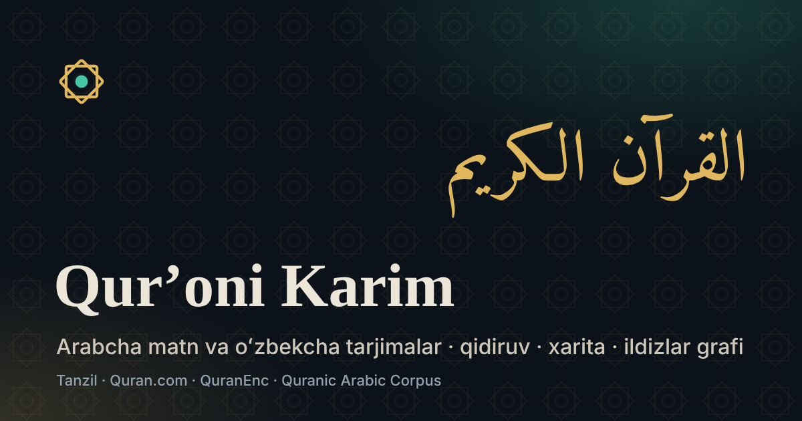

# Qurʼoni Karim — oʻzbekcha tarjimalar

**Sayt:** https://faxriddin006.github.io/Quran_uz/

> ⚠️ **Bir martalik sozlash.** Sayt ochilishi uchun repozitoriyda GitHub Pages yoqilgan boʻlishi kerak:
> **Settings → Pages → Build and deployment → Source: «GitHub Actions»**. Soʻng **Actions** boʻlimida
> oxirgi «GitHub Pages» ishini *Re-run* qiling (yoki yangi commit yuboring). Shundan keyin har bir push avtomatik joylanadi.



Arabcha Usmoniy matn va oʻzbekcha tarjimalar bilan Qurʼon oʻqish uchun tezkor, mobil qurilmalarga moslashgan statik sayt.

## Imkoniyatlar

| Boʻlim | Nima qiladi |
|---|---|
| **Oʻqish** (`#2`, `#2:255`) | Tanzil Usmoniy arabcha matni (Amiri Quran shrifti, RTL), **arabcha matnning kirillcha oʻqilishi (талаффуз)** va oʻzbekcha tarjimalar 3 koʻrinishda: **Yonma-yon**, **Ketma-ket**, **Mushaf sahifasi** (604 Madina mushafi sahifalari). Juz/Hizb/Sahifa ajratgichlari, sajda oyati belgisi (`۩`), sura ichidan filtrlash, izohlar, tafsir, har bir soʻzning ildizi va pastki **Audio mini-pleyer** (5 arab qorisi + **Oʻzbekcha ketma-ket audio** va **Arabcha + Oʻzbekcha ketma-ket** rejimi, tezlik `0.85×–1.25×`, takrorlash `1×/2×/3×/∞`, MediaSession) |
| **Tezkor oʻtish** (`Ctrl+K`, `/`) | Istalgan sahifadan tabiiy tilda tezkor oʻtish: `2:255`, `Baqara 255`, `Yosin`, `30-juz`, `50-sahifa`, `sajda` |
| **Qidiruv** (`#/qidiruv`) | Oldindan qurilgan MiniSearch indeksi + arabcha matn boʻyicha qidiruv (`normAr`). Lotin, kirill (`rahmat` = `раҳмат`), fonetik oʻzbekcha sura nomlari (`Fotiha`, `Yosin`, `Ixlos`, `Voqea`) va sura/Makkiy-Madaniy filtrlari |
| **Suralar xaritasi** (`#/xarita`) | 114 sura — yuzasi oyatlar soniga mutanosib treemap; Makkiy/Madaniy filtri, sura qidiruvi va mushaf/nuzul/hajm tartiblari orasida animatsiyali oʻtish |
| **Ildizlar grafi** (`#/ildizlar`) | Suralar va 1642 arabcha ildiz (Quranic Arabic Corpus) grafi (Sigma.js). Soʻz shakllari boʻyicha oyatlarni filtrlash, umumiy ildizlar boʻyicha yaqin suralar (Jaccard), TF-IDF xos ildizlar |
| **Juz va sahifalar** (`#/juz`, `#/sahifa`) | 30 juz va 60 hizb (240 chorak), **604 Mushaf sahifasi**, **15 sajda oyati** va **7 manzil** (Tanzil metamaʼlumotlari) |
| **Saqlanganlar** (`#/xatchop`) | Saqlangan oyatlar, har bir oyat uchun shaxsiy qayd (`note`), oʻqish tarixi (foiz koʻrsatkichi bilan) hamda JSON eksport/import (`localStorage`) |
| **Manbalar** (`#/manbalar`) | Har bir manba, litsenziya matni, fayl xeshlari |

Qorongʻi/yorugʻ mavzu, WCAG AA kontrast, Lighthouse (bosh sahifa): Performance 100, Accessibility 100, Best Practices 100, SEO 100.

## Asosiy qoida: matnlar oʻzgartirilmaydi

Sayt Qurʼon matni, tarjima, izoh yoki tafsirni **oʻzi yaratmaydi, qayta ifodalamaydi va «tuzatmaydi»**. Barcha matnlar nashr qilingan manbalardan soʻzma-soʻz olinadi va `data/raw/` papkasida asl holida saqlanadi. `scripts/build-data.mjs` har bir manbada oyatlar soni (6236) va tartibini tekshiradi; mos kelmasa build toʻxtaydi.

Qidiruv uchungina (ekranda emas) matn normallashtiriladi: kichik harf, apostrof turlari, kirill→lotin.

## Manbalar va litsenziyalar

| Maʼlumot | Manba | Litsenziya / shartlar |
|---|---|---|
| Arabcha matn | [Tanzil Quran Text](https://tanzil.net/download/) — Usmoniy, 1.1-versiya (XML) | CC BY 3.0 + «matnni oʻzgartirish mumkin emas», manba va tanzil.net havolasini koʻrsatish |
| Metamaʼlumotlar | [Tanzil quran-data.js](https://tanzil.net/docs/quran_metadata) (1.0) | CC BY 3.0 |
| Muhammad Sodiq Muhammad Yusuf (lotin) + 1797 izoh | [Quran.com API v4](https://api.quran.com/api/v4/quran/translations/55), resurs 55 | **Aniq ochiq litsenziya topilmadi** (2026-11-05). Huquq tarjimon/noshirga tegishli; notijorat, oʻzgartirishsiz, manba bilan |
| Muhammad Sodiq Muhammad Yusuf (kirill) | [QuranEnc — uzbek_sadiq](https://quranenc.com/en/browse/uzbek_sadiq) | QuranEnc shartlari (pastda) |
| Alouddin Mansur (kirill) | [QuranEnc — uzbek_mansour](https://quranenc.com/en/browse/uzbek_mansour) v1.0.0 | QuranEnc shartlari |
| Tafsir: Al-Muxtasar | [QuranEnc — uzbek_mokhtasar](https://quranenc.com/en/browse/uzbek_mokhtasar) | QuranEnc shartlari |
| Tafsir: At-Tafsir al-Muyassar | [QuranEnc — uzbek_moyassar](https://quranenc.com/en/browse/uzbek_moyassar) | QuranEnc shartlari |
| Ildizlar (morfologiya) | [Quranic Arabic Corpus](https://corpus.quran.com/download/) v0.4 | GNU GPL + «faylni oʻzgartirish mumkin emas», manba va havola |
| Sura nomlari (lotin) | Quran.com API v4 `chapters` (`name_simple`) | — |
| Audio | [EveryAyah.com](https://everyayah.com/) (fayllar saytda saqlanmaydi, brauzer toʻgʻridan-toʻgʻri yuklaydi) | Aniq shartlar topilmadi (2026-11-05) |
| Shrift | [Amiri Quran](https://github.com/aliftype/amiri) | SIL OFL 1.1 (`public/fonts/OFL-Amiri.txt`) |

**QuranEnc shartlari** (asl matni «Manbalar» sahifasida): mazmunni oʻzgartirmaslik, qoʻshmaslik va oʻchirmaslik; noshir va manbani (QuranEnc.com) aniq koʻrsatish; qayta nashrda versiya raqamini koʻrsatish; tarjimadagi maʼlumotlarni saqlash; xatolar haqida QuranEnc'ga xabar berish; eng soʻnggi versiyaga yangilab turish; nomaqbul reklama qoʻymaslik.

### Tekshirilgan, lekin ishlatilmagan

- **fawazahmed0/quran-api** — undagi barcha oʻzbekcha nashrlar kirill yozuvida va asl manbalarning nusxalari (nuqtalar/oyat raqamlari olib tashlangan). `uzb-alaaudeenmansou` nashri Alouddin Mansur nomi bilan berilgan, lekin mazmunan **Muhammad Sodiq tarjimasi** (6236 oyatdan 3945 tasi aynan bir xil). Shuning uchun asl manbalar bevosita ishlatildi.
- **Tanzil `uz.sodik`** — Muhammad Sodiq tarjimasining 2011-yilgi nashri; yangiroq QuranEnc nashri tanlandi.
- **QuranEnc `uzbek_rwwad`** (Ruvvod markazi) — mavjud, talabda yoʻqligi uchun kiritilmadi.

### Sunʼiy intellekt haqida

Sayt kodi sunʼiy intellekt (Claude) yordamida yozilgan. Matnlar AI tomonidan yaratilmagan va oʻzgartirilmagan. Ildizlar grafi va «suraga xos ildizlar» (TF-IDF) algoritm bilan hisoblanadi — bu tafsir yoki mavzu tasnifi emas. Saytda AI yaratgan mavzu teglari yoʻq; kelajakda qoʻshilsa, «AI tomonidan guruhlangan, tekshirilmagan» deb belgilanadi.

## Ishga tushirish

Node.js 22+ kerak.

```bash
npm ci
```

```bash
npm run dev
```

```bash
npm run build
```

`npm run build` — `data/raw/` dan `public/data/` ni yaratadi (tekshiruvlar, qidiruv indeksi, graf joylashuvi ~10 s), TypeScript'ni tekshiradi va saytni `dist/` ga quradi.

## Maʼlumotlarni yangilash

1. Manbalarni qayta yuklab oling (Tanzil, Quran.com, QuranEnc, Corpus; ~5 daqiqa):

```bash
node scripts/fetch-data.mjs
```

2. Oʻzgarishlarni koʻrib chiqing — qaysi fayllar yangilangani va nima oʻzgargani:

```bash
git diff --stat data/raw
```

3. Qayta quring (oyatlar soni/tartibi avtomatik tekshiriladi):

```bash
npm run build
```

4. Commit qiling va push qiling — GitHub Actions saytni qayta joylaydi.

Eslatmalar:
- QuranEnc shartlariga koʻra tarjimalarni eng soʻnggi versiyada saqlash kerak — vaqti-vaqti bilan 1-qadamni bajaring.
- Quranic Arabic Corpus rasmiy sayti yuklash uchun e-pochta soʻraydi, shuning uchun skript GitHub nusxasini yuklaydi va SHA-256 xeshini tekshiradi (`910b721a…`). Xesh mos kelmasa, fayl yozilmaydi.
- Yangi tarjima qoʻshish: `scripts/fetch-data.mjs` dagi `QENC_KEYS` ga kalit qoʻshing va `scripts/build-data.mjs` dagi `EDITIONS` roʻyxatini kengaytiring.

## Tuzilma

```
data/raw/            asl manbalar (soʻzma-soʻz)
scripts/
  fetch-data.mjs     manbalarni yuklash
  build-data.mjs     public/data/ yaratish + tekshiruvlar + qidiruv indeksi
  build-roots.mjs    ildizlar grafi (ForceAtlas2 joylashuvi)
src/
  main.ts            router (#2:255, #/qidiruv, #/xarita, #/ildizlar, …)
  views/             reader, search, map, graph, juz, bookmarks, sources, home
  lib/normalize.ts   qidiruv normallashtirish (build va brauzer uchun umumiy)
.github/workflows/deploy.yml   GitHub Pages'ga joylash
```
